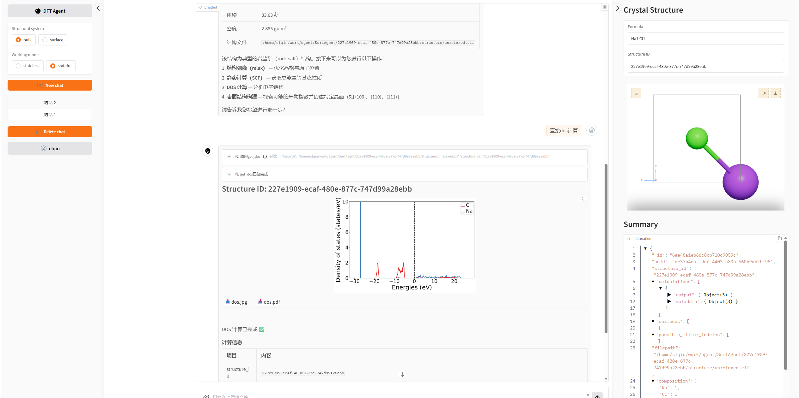

4. DFT Agent
>>>>>>>>>>>>

**DFT Agent** is an LLM-driven agent for computational surface science shipped
together with pymatsci as the ``SurfAgent`` package. It turns a natural-language
request such as *"cleave the (111) surface of fcc Ni and relax it"* into a
sequence of concrete operations: querying structural databases, cleaving slabs
with the requested Miller index and termination, generating VASP input files,
submitting the job, parsing the output and finally presenting the result as an
interactive 3D structure, a DOS curve or a downloadable file.

The agent does not replace pymatsci, it calls it. Every step of the workflow is
a *tool* wrapping pymatgen, atomate2 and dpdispatcher; the language model only
decides which tool to call and with which arguments. Numerical correctness
therefore stays under the control of the underlying libraries and of the input
settings you configure, which is what makes the agent usable for production
runs and not only for demonstrations.

   The DFT Agent interface: chat area in the centre, session and mode control
   on the left, crystal viewer and structure summary on the right.

4.1 Capabilities at a glance
::::::::::::::::::::::::::::

.. list-table::
   :header-rows: 1

   * - Stage
     - What you can ask
     - Tool behind it
   * - Structure input
     - "find NaCl in Materials Project", "use my POSCAR"
     - ``search_materials_project``, ``get_struc_from_path``
   * - Surface construction
     - "which facets are possible?", "make all (110) terminations"
     - ``get_possible_hkl``, ``get_hkl_surface``
   * - Relaxation
     - "relax this slab", "optimise the bulk cell"
     - ``get_relax``
   * - Energy
     - "run a static calculation", "total energy per atom"
     - ``get_scf``
   * - Electronic structure
     - "give me the DOS", "which states come from Ni 3d?"
     - ``get_dos``
   * - Presentation
     - 3D viewer, download links, summary panel, session history
     - built-in user interface

Every tool is a normal Python function decorated with ``@tool``; there is no
prompt engineering hidden in the numerical path. If you disagree with a default
(``ENCUT``, ``ISPIN``, slab thickness, ...) you change it in the source file and
the agent picks the new behaviour up immediately.

4.2 How a request is processed
::::::::::::::::::::::::::::::

A single chat turn travels through five layers.

.. code:: text

   user message (text + optional cif)
        |
        v
   Gradio chat  ------------------------------------+
        |                                           |
        v                                           |
   LangGraph agent node  <-- system prompt, history |
        |  decides: which tool, which arguments      |
        v                                           |
   tool node (pymatgen / atomate2 / dpdispatcher)    |
        |                                           |
        +--> writes files under ROOT/<structure_id>/|
        +--> returns ToolMessage with an "artifact" |
        |                                           |
        v                                           |
   assistant node -> final answer -------------------+

1. **Interface layer** — ``SurfAgent/main.py`` collects the message, the
   attached CIF files, the structural system (``bulk``/``surface``), the working
   mode and the session id, then streams the graph.
2. **Agent layer** — ``SurfAgent/graph.py`` compiles a two-node LangGraph state
   machine (``agent`` and ``tools``). The language model is a
   ``ChatDeepSeek`` instance configured from ``.env``; the tool set bound to it
   depends on the structural system, so the model never sees a surface tool when
   it is working on a bulk crystal.
3. **Tool layer** — ``SurfAgent/tools/`` holds the numerical work: structure
   retrieval in ``get_structure.py`` and VASP jobs in ``calculation.py``.
4. **Execution layer** — VASP input files are written with atomate2 makers and
   the job is pushed by ``utils/run_dpdispatcher.py``, so the same tool works on
   a laptop (local shell) and on a cluster simply by editing ``config.py``.
5. **Presentation layer** — each tool returns a ``Command`` whose
   ``ToolMessage`` carries an ``artifact`` dictionary. Keys starting with
   ``text`` become Markdown, ``html`` becomes an embedded viewer or download
   links and ``image`` becomes a figure; the same call also updates the right
   hand panels.

Because a tool returns a ``Command`` instead of a plain string, the agent can
update both the conversation and the structured state of the project in one
step. This is why the right panel always shows the structure that the assistant
is currently talking about.

4.3 Installation
::::::::::::::::

The agent shares the pymatsci namespace but has extra dependencies:

.. code:: console

   pip install pymatsci
   pip install langgraph langchain langchain-deepseek \
               atomate2 jobflow dpdispatcher maggma \
               gradio fastapi uvicorn python-dotenv rich \
               aseview crystal-toolkit dash

In addition you need:

* a VASP executable named ``vasp_std`` on the ``PATH`` of the machine that runs
  the job, with valid ``POTCAR`` files registered through ``PMG_VASP_PSP_DIR``;
* a Materials Project API key (only needed for the database search tool);
* an LLM API endpoint and key.

4.3.1 Configuration file
''''''''''''''''''''''''

Create ``SurfAgent/.env`` (a template is shipped in the repository):

.. code:: text

   LLM_MODEL_ID   = <model name>
   LLM_API_KEY    = <api key>
   LLM_BASE_URL   = <openai-compatible endpoint>

   deepseek-api   = <deepseek key>      # used by ChatDeepSeek in graph.py
   aliQwen-api    = <dashscope key>

   mp-api         = <materials project key>

``config.py`` holds everything that is machine specific:

.. code:: python

   machine_dict = {
       "batch_type": "Shell",          # 提交后端：本地 shell / slurm / pbs
       "context_type": "Local",        # 执行上下文：本地或 ssh
       "local_root": str(ROOT_DIR),
       "remote_root": "/path/to/DPDispatcher/remote_root"
   }
   resources_dict = {
       "cpu_per_node": 10,
       "gpu_per_node": 1,
       "group_size": 1,
       "module_list": ["vasp"],        # 需要在计算节点加载的 module
       "source_list": [],              # 例如 ["~/.bashrc"]
       "envs": {},
       "prepend_script": []
   }

Change ``batch_type``/``context_type`` together with ``module_list`` and
``prepend_script`` to target your cluster; nothing else in the code has to be
touched.

4.4 Launching the application
:::::::::::::::::::::::::::::

The package must be importable as ``Pymatsci.SurfAgent``, so place the
repository in a directory called ``Pymatsci`` and start the module from its
parent:

.. code:: console

   cd /home/clqin/work/agent
   python -m Pymatsci.SurfAgent.main

The service listens on ``http://127.0.0.1:7860``. On first start three SQLite /
JSON stores are created under ``SurfAgent/database/`` (see section 4.10). For
remote use, forward the port over SSH instead of binding the app to a public
interface:

.. code:: console

   ssh -N -L 7860:127.0.0.1:7860 clqin@your.server

4.5 The interface
:::::::::::::::::

**Left sidebar** — session control.

* ``Structural system``: ``bulk`` or ``surface``. It decides which tools the
  model is allowed to call.
* ``Working mode``: ``stateful`` keeps the full conversation, ``stateless``
  sends only the latest message plus a machine-generated summary of the current
  structure (see section 4.9).
* ``New chat`` / ``Delete chat`` and the list of recent conversations; history
  is stored per user so a session can be resumed days later.
* The user button at the bottom simply carries the user id used to tag sessions.

**Centre panel** — the conversation. Assistant answers are Markdown; tool calls
appear as collapsible cards showing the arguments and the completion status.
Generated figures (DOS curves) and download links (``.cif``, ``.pdf``, raw
outputs) are inserted inline, so the chat itself is the report.

**Right sidebar** — the state of the current structure.

* ``Formula`` and ``Structure ID``: the identifier that every tool uses as a
  handle; all files of a project live under ``ROOT/<structure_id>/``.
* Crystal viewer: an interactive HTML viewer (rotation, zoom, cell edges)
  regenerated after every structural step.
* ``Summary``: the JSON document of the structure, listing ``calculations``,
  ``surfaces`` and ``possible_miller_indcies`` accumulated so far.

4.6 Obtaining a structure
:::::::::::::::::::::::::

4.6.1 From the Materials Project
''''''''''''''''''''''''''''''''

Ask in natural language, for example *"find the NaCl structure with the lowest
energy above hull"*. The model translates the request into the criteria
accepted by ``search_materials_project``:

.. code:: text

   material_id, formula, elements, exclude_elements, band_gap,
   energy_above_hull, num_sites, spacegroup_number,
   crystal_system, is_gap_direct

The first hit is registered as a new structure: a CIF is written to
``ROOT/<structure_id>/structure/unrelaxed.cif``, a document is inserted in the
job store, and the viewer plus the summary panel are refreshed. Every candidate
returned by the API is available for inspection in the summary JSON, so you can
ask the assistant to switch to another polymorph without repeating the search.

4.6.2 From a local file
'''''''''''''''''''''''

Drag a ``.cif`` onto the input box (only CIF files are accepted by the widget),
or tell the assistant the path of a file that already exists on the server. The
tool ``get_struc_from_path`` reads it with ``Structure.from_file``, derives
composition, volume, density and symmetry metadata, and creates a fresh
``structure_id``. The same file can be downloaded again later from the
``📥`` link in the answer, which makes the chat a reproducible record of the
input.

4.7 Building surfaces
:::::::::::::::::::::

4.7.1 Possible Miller indices
'''''''''''''''''''''''''''''

.. code:: text

   user > which low-index facets does this bulk have?
   agent> calling get_possible_hkl(max_miller_index=2)

``get_possible_hkl`` calls ``get_symmetrically_distinct_miller_indices`` and
stores the symmetrically distinct facets in
``summary["possible_miller_indcies"]`` together with the maximum index used.
This is the cheapest way to decide which surfaces are worth a calculation,
because it uses only the space group of the bulk.

4.7.2 Slabs and terminations
''''''''''''''''''''''''''''

.. code:: text

   user > make all the (110) terminations with 6 A of slab and 15 A of vacuum
   agent> calling get_hkl_surface(miller_index=[1, 1, 0],
                                 min_slab_size=6,
                                 min_vacuum_size=15,
                                 terminations=True)

The slab generator is used with ``primitive=False`` and ``center_slab=True``, so
the cell is the conventional one and the vacuum is symmetric. With
``terminations=True`` all the terminations of that facet are returned; each of
them becomes an independent structure with its own ``structure_id``, its own
``unrelaxed.cif`` and its own 3D preview, and records ``composition``,
``surface_area``, ``miller_index``, ``termination_id`` and a link back to the
``bulk_structure_id``. Comparing terminations is then a matter of relaxating
each one and looking at the energies in the summary panel.

4.8 Running DFT calculations
::::::::::::::::::::::::::::

All three calculation tools follow the same five steps:

1. build the input set with an atomate2 maker;
2. write ``INCAR``, ``POSCAR``, ``POTCAR`` and ``KPOINTS`` into
   ``ROOT/<structure_id>/jobflow``;
3. submit through dpdispatcher (``mpirun -np 4 vasp_std`` by default), forwarding
   the four input files and retrieving ``vasprun.xml``, ``OUTCAR`` and
   ``CONTCAR``;
4. parse the directory with ``get_vasp_task_document`` and store the resulting
   document in the job store;
5. extract a small, human-readable ``calc_info`` — energy, energy per atom,
   volume, density, symmetry, task state — and push it into the chat and the
   summary.

4.8.1 Relaxation
''''''''''''''''

.. code:: python

   my_custom_set = RelaxSetGenerator(user_incar_settings={"ENCUT": 200, "ISPIN": 1})
   maker = RelaxMaker(input_set_generator=my_custom_set)

The relaxed structure is written to
``ROOT/<structure_id>/structure/relaxed.cif`` and becomes the structure that
subsequent tools operate on, so a chain *"relax, then static, then DOS"* needs
no manual bookkeeping: the assistant simply passes the new ``filepath`` to the
next tool. Use this tool for the bulk cell as well; relaxing the bulk before
cleaving is what keeps the surface energy meaningful.

4.8.2 Static calculation
''''''''''''''''''''''''

``get_scf`` uses ``StaticMaker`` with the same ``ENCUT``/``ISPIN`` overrides and
reports total energy and energy per atom. Because the SCF charge density is
kept in the jobflow directory, it is the natural parent of a DOS run.

4.8.3 Density of states
'''''''''''''''''''''''

.. code:: text

   user > compute the DOS and tell me which atoms contribute near the Fermi level
   agent> calling get_dos(filepath=.../relaxed.cif)

``get_dos`` builds a ``BandStructureMaker(bandstructure_type='uniform')`` flow:
a static run produces ``CHGCAR``, which is forwarded to the non-scf run, and the
resulting DOS is parsed into a ``CompleteDos`` object. Two figures,
``figures/dos.jpg`` and ``figures/dos.pdf``, are plotted with the element
projected contributions and shown in the chat; both are downloadable, the PDF
being the version to drop into a paper. The full DOS document stays in the job
store, so questions such as *"what is the value at the Fermi level"* can be
answered without recomputing anything.

4.9 Working modes
:::::::::::::::::

``Structural system`` selects the tool set:

* ``bulk`` exposes structure retrieval, calculations **and** the two surface
  construction tools, which is the mode to use for the whole
  bulk → facet → slab chain;
* ``surface`` exposes retrieval and calculations only. It is meant for
  adsorption and interface work on slabs you have already built, where the
  slab-generation tools are not needed.

``Working mode`` selects how much conversation the model sees:

* ``stateful`` — the complete history is replayed from the SQLite checkpointer
  (``database/langraph.db``, one thread per session). Best for exploratory work.
* ``stateless`` — only the last message is sent, prefixed by the current
  structure summary serialised as text. This keeps the context small and stable
  during long calculation campaigns, and makes answers independent of earlier
  chatter, which is useful when you want the same question to give the same
  answer twice.

4.10 Where the data is written
::::::::::::::::::::::::::::::

Everything is relative to ``ROOT_DIR``, the directory containing ``main.py``:

.. code:: text

   SurfAgent/
   ├── database/
   │   ├── docs.json        # structure and calculation documents (maggma JSONStore)
   │   ├── data.json        # large objects, e.g. serialised DOS
   │   ├── langraph.db      # LangGraph checkpoints, one thread per session
   │   └── gradio.db        # chat sessions and messages
   ├── <structure_id>/
   │   ├── structure/       # unrelaxed.cif, relaxed.cif
   │   ├── jobflow/         # VASP inputs and outputs of the last run
   │   └── figures/         # dos.jpg, dos.pdf
   └── index.html           # latest crystal viewer, served at /viewer/index.html

Because the identifier is a UUID, several structures can be studied in the same
session without collisions, and the whole directory can be archived or copied to
another machine as a self-contained record of the work.

4.11 A complete example
:::::::::::::::::::::::

.. code:: text

   user > 从 Materials Project 找 NaCl，然后给我 (100) 面，弛豫之后算 DOS

   agent> calling search_materials_project(formula="NaCl", limit=1)
   → Structure ID: 227e1909-ecaf-480e-877c-747d99a28ebb
     formula NaCl, 2 sites, Fm-3m

   agent> calling get_possible_hkl(max_miller_index=1)
   → [(0, 0, 1)]

   agent> calling get_hkl_surface(miller_index=[0, 0, 1],
                                  min_slab_size=5, min_vacuum_size=15)
   → 1 termination, surface area 33.63 A^2, new structure_id

   agent> calling get_relax(...)
   → E = -13.62 eV, E/atom = -6.81 eV, a = 5.80 A

   agent> calling get_dos(...)
   → dos.jpg, dos.pdf

   agent> NaCl(100) 已完成弛豫与 DOS 计算。价带顶主要由 Cl 3p 贡献，
          导带底由 Na 3s 贡献，带隙约 5.1 eV（PBE，ENCUT = 200 eV）。

At every step the answer references the structure by its ID, and the three
panels stay synchronised: the viewer shows the slab, the summary lists one
``calculations`` entry per run, and the chat holds the downloadable files.

4.12 Adding your own tool
:::::::::::::::::::::::::

The agent is extended by adding a function, not by changing the prompt. A tool
takes the ``ToolRuntime`` (for the call id and the state) plus ordinary typed
arguments, and returns a ``Command`` that updates the messages:

.. code:: python

   from langchain.tools import tool
   from langgraph.prebuilt import ToolRuntime
   from langgraph.types import Command
   from langchain_core.messages import ToolMessage

   @tool(parse_docstring=True)
   def get_work_function(runtime: ToolRuntime, filepath: str, structure_id: str):
       """
       计算表面的功函数

       Args:
           filepath: 结构文件路径
           structure_id: 结构唯一标识
       """
       tool_call_id = runtime.tool_call_id
       value = ...  # 从 OUTCAR/LOCPOT 读取真空能级与费米能级
       artifact = {'chatbox': {'text-1': f"功函数 = {value:.2f} eV"}}
       return Command(update={"messages": [ToolMessage(
           f"功函数计算完成：{value:.2f} eV",
           artifact=artifact, tool_call_id=tool_call_id)]})

Register it in ``graph.py`` in the list matching the structural system
(``surface_tools`` for surface-only tools, ``common_tools`` for everything), and
the model will start calling it immediately — the docstring is the only thing it
reads, so describe the arguments precisely.

4.13 Known limitations
::::::::::::::::::::::

The agent is under active development. The points below are the ones that matter
before using it for production:

* ``ENCUT`` (200 eV) and ``ISPIN`` (1) are hard-coded in ``calculation.py`` as
  placeholders for fast tests. Set them to converged values, and check that the
  ``POTCAR`` chosen by pymatgen matches the potentials used in your project.
* ``surface_tools`` is currently empty, so slab construction is reached through
  ``bulk`` mode; dedicated adsorption and interface tools are being integrated.
* ``get_band`` is a stub: band structures along a k-path are not yet parsed,
  only the uniform DOS is.
* ``dpdispatcher`` runs jobs synchronously and waits for the result, so a chat
  turn lasts as long as the calculation. For long runs, submit manually or move
  to an asynchronous flow with a queue.
* The user id in the interface is fixed; multi-user authentication is not
  implemented.
* The crystal viewer writes a single ``index.html`` per request, which is why
  the iframe URL carries a timestamp; parallel users may occasionally see each
  other's structure for one frame.
